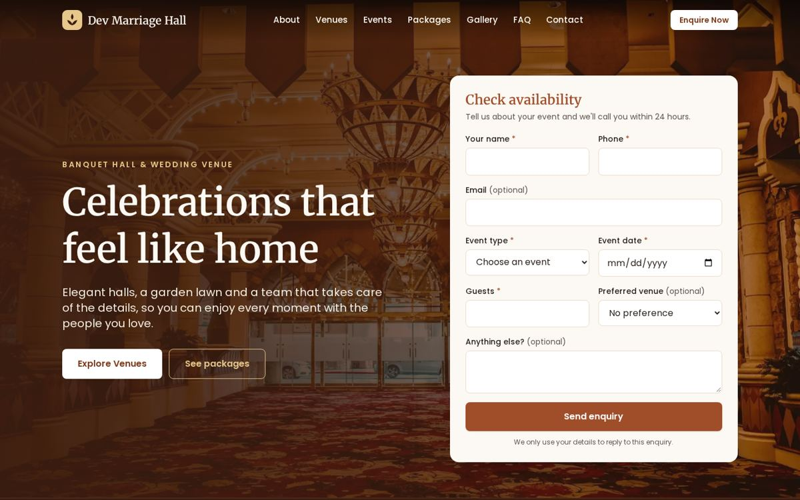
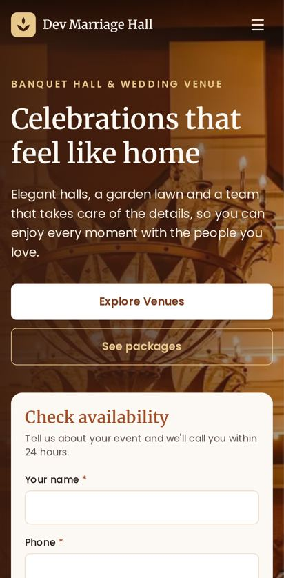

# Dev Marriage Hall: Banquet & Wedding Venue Website

Website for Dev Marriage Hall: venues, packages, gallery, and online enquiries.





## Features

- Responsive marketing site (Home, About, Venues, Events, Packages, Gallery, FAQ, Contact, Privacy)
- Online enquiry and contact forms with shared validation (the same Zod schema runs in the browser and the API)
- Enquiries stored in SQLite, with email confirmation to the customer and notification to the owner
- Excel export of enquiries for the team
- SEO: per-page meta, structured data (EventVenue, FAQPage), sitemap
- Accessible: keyboard navigation, focus management, reduced-motion support, axe-tested on every page

## Tech stack

React 19 · Vite · React Router · Tailwind CSS v4 · Express 5 · SQLite (better-sqlite3) · Zod · Nodemailer · Vitest · Playwright

## Project structure

```
apps/web        → frontend (content in src/content)
apps/api        → backend API
packages/shared → validation schemas shared by both
e2e/            → Playwright tests
docs/           → architecture, API, content, deployment guides
```

## Getting started

Requirements: Node 24 (see `.nvmrc`; ≥ 22 works), npm ≥ 10.

```bash
git clone https://github.com/deveshkumar0902/Banquet_Intern.git
cd Banquet_Intern
npm install
npx playwright install chromium          # only needed for e2e tests
npm run doctor                           # verifies tools & dependencies
cp apps/api/.env.example apps/api/.env   # optional in development
npm run dev                              # web: http://localhost:5173  api: http://localhost:4000
```

With no `.env`, the API uses development defaults and prints emails to the console instead of sending them.

## Scripts

| Command                                          | What it does                                  |
| ------------------------------------------------ | --------------------------------------------- |
| `npm run doctor`                                 | check toolchain and dependencies              |
| `npm run dev`                                    | run web + api together                        |
| `npm test`                                       | unit and integration tests                    |
| `npm run test:e2e`                               | Playwright end-to-end and accessibility tests |
| `npm run lint` / `npm run format`                | lint / format                                 |
| `npm run build`                                  | production build of the website               |
| `npm run check`                                  | everything CI runs (except e2e)               |
| `npm run export -w apps/api -- --type enquiries` | export enquiries to Excel                     |

## Editing content

All text, prices, venues, FAQs, and images live in `apps/web/src/content/`. See [docs/CONTENT.md](docs/CONTENT.md).

## Environment variables

See `apps/api/.env.example` and `apps/web/.env.example`, and [docs/DEPLOYMENT.md](docs/DEPLOYMENT.md).

## Deployment

Frontend → GitHub Pages (automatic on `main` after CI passes). Backend → Node host with a persistent disk. Details in [docs/DEPLOYMENT.md](docs/DEPLOYMENT.md).

## Documentation

[Architecture](docs/ARCHITECTURE.md) · [API](docs/API.md) · [Content](docs/CONTENT.md) · [Testing](docs/TESTING.md) · [Deployment](docs/DEPLOYMENT.md) · [Design](docs/DESIGN.md)

## Contributors

Devesh Kumar · Rohil · Pushkar
