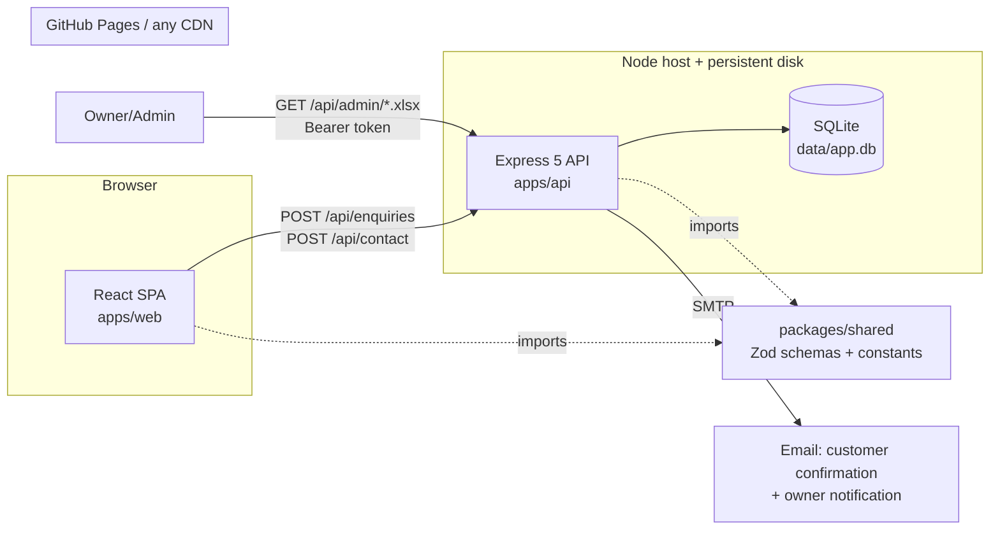
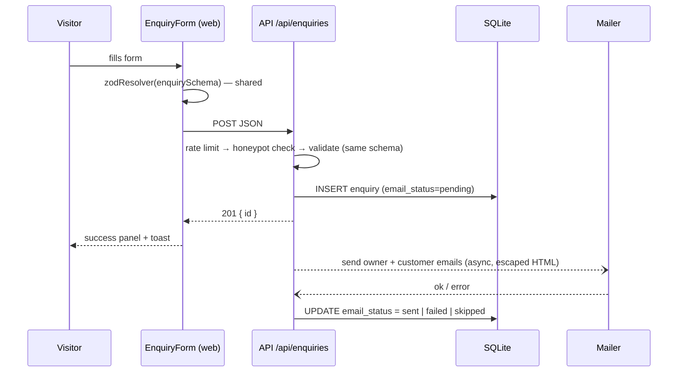

# Architecture



## Folder map

```
apps/web/
  src/app/routes.js        single list of routes → router, header/footer nav, sitemap
  src/app/App.jsx          router + lazy-loaded pages
  src/pages/               one file per route; inner pages use InnerPage (Seo + PageHero + CtaBand)
  src/sections/home/       home page sections; sections/shared/ PageHero, CtaBand, VenueCard, PackageCard
  src/components/ui/       Button, Section, Accordion, Carousel, Lightbox, Seo, ResponsiveImage, …
  src/components/layout/   Layout, Header, MobileNav, Footer, ScrollManager, FloatingContact
  src/components/forms/    EnquiryForm, ContactForm, FormField, useSubmit
  src/content/             ALL copy and data (JSON/JS) + schema.js
  src/lib/                 api.js (the only fetch), seo.js, images.js, links.js, content.js, format.js
  scripts/postbuild.mjs    sitemap.xml, robots.txt Sitemap line, 404.html
apps/api/
  src/server.js            reads env, opens db, builds mailer, listens
  src/app.js               createApp({ config, db, mailer, logger }), no listen, used by tests
  src/config/env.js        Zod-validated env; dev defaults, production strict
  src/db/                  openDb() + numbered SQL migrations
  src/routes/              health, submissions (enquiries + contact), admin
  src/services/            enquiryService, contactService, mailService, exportService
  src/middleware/          validate, errorHandler, notFound, adminAuth, rateLimits
  src/templates/email/     HTML + plain-text templates, wrapped in _layout.html
  scripts/                 export.mjs, import-legacy-xlsx.mjs
packages/shared/src/       constants.js, schemas/{enquiry,contact,fields}.js, errors.js
e2e/                       Playwright smoke, navigation, forms, axe
```

## Request flow for an enquiry



A mail failure never changes the HTTP response; it is recorded in `email_status` and logged.

## Design decisions

| Topic         | Decision                                                               | Why                                                                  |
| ------------- | ---------------------------------------------------------------------- | -------------------------------------------------------------------- |
| Repo layout   | npm workspaces monorepo: `apps/web`, `apps/api`, `packages/shared`     | One install, one CI, shared code                                     |
| Frontend      | React 19 + Vite + React Router (declarative SPA) + Tailwind CSS v4     | Close to the old stack; React 19 renders `<title>`/`<meta>` natively |
| Site content  | Bundled JSON/JS in `apps/web/src/content/`                             | Static marketing content; the site works even if the API is down     |
| Backend scope | Forms only (enquiry, contact), admin export, health                    | Small surface, easy to secure                                        |
| Validation    | Zod schemas in `packages/shared`, used by the forms and the API        | Front/back field mismatches can't happen                             |
| Storage       | SQLite (better-sqlite3, WAL) + Excel export on demand (exceljs)        | A real database; the team keeps its Excel workflow                   |
| Email         | Nodemailer, sent after responding; JSON transport + console log in dev | Non-blocking; runs locally without SMTP                              |
| Testing       | Vitest (web, api, shared), Testing Library, Supertest, Playwright, axe | One runner everywhere                                                |
| Ports         | web 5173, api 4000                                                     | 5000 collides with macOS AirPlay                                     |

## How to…

### Add a page

1. Create `apps/web/src/pages/MyPage.jsx` using `<InnerPage page="my">…</InnerPage>`.
2. Add an entry to `src/app/routes.js` (`path`, `page: 'my'`, `label`, `title`, `description`, `nav`, `sitemap`).
3. Add `my: lazy(() => import('../pages/MyPage.jsx'))` to `PAGES` in `src/app/App.jsx`.
   Header, footer, sitemap, the routing unit test and the e2e smoke/axe tests pick it up automatically.

### Add a venue

Add an object to `src/content/venues.json` (see [CONTENT.md](CONTENT.md)) and drop its photos into
`src/assets/images/venues/`. The venue gets a card, a detail page at `/venues/<slug>`, a form option and a sitemap entry.

### Add a form field

1. Add it to the schema in `packages/shared/src/schemas/enquiry.js` (or `contact.js`).
2. Add a column with a new migration `apps/api/src/db/migrations/002_<name>.sql` and include it in the
   `INSERT` in `services/enquiryService.js` (and the export columns in `exportService.js`).
3. Add a `<FormField>` to `EnquiryForm.jsx`, and the value to the email templates if the owner should see it.
4. Update the tests (`packages/shared/tests`, `apps/api/tests/api.test.js`, `apps/web/tests/forms.test.jsx`).
