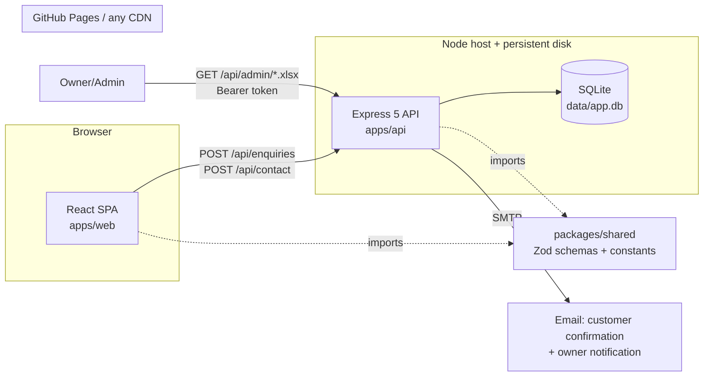
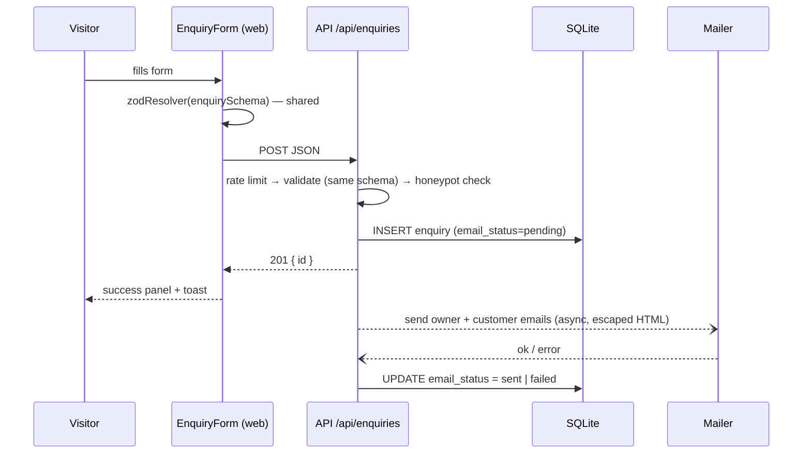

# Banquet Site — Full Rebuild Plan (for autonomous execution by Claude Code)

> **Repo:** https://github.com/deveshkumar0902/Banquet_Intern
> **UI reference:** https://destinationweddingbharat.com/ ("Destination Wedding Planners in India")
> **Plan version:** 1.0 (written 2026‑11‑01)

---

## 0. How to use this plan

1. Put this file at the root of the cloned repo as `REBUILD_PLAN.md`.
2. Fill in **§1 Project facts** (anything you leave blank becomes a `TODO(owner)` placeholder. The build doesn't stop for it).
3. Start Claude Code in the repo root and paste:

```text
Read REBUILD_PLAN.md completely before doing anything. Then execute it phase by phase,
starting with Phase 0 (the preflight gate). Do not write any application code until
Phase 0 passes. Work on the branch `rebuild/v2`. After each phase run that phase's
"Verify" commands, fix failures, then commit with the phase's commit message.
Only stop for the conditions in §19 "Stop conditions". When finished, write
docs/REBUILD_REPORT.md as described in Phase 12.
```

### Operating rules for Claude Code (apply to every phase)

- **Gate first:** Phase 0 must pass (all `FAIL` lines resolved) before any app code is written. Re-run `npm run doctor` after any dependency change.
- **Versions:** install the **latest stable** versions with `npm install <pkg>` (no hand‑pinned numbers in this plan). If a peer‑dependency conflict appears, resolve it by choosing compatible versions. Never use `--force` or `--legacy-peer-deps` without writing down why in the report.
- **ESM everywhere** (`"type": "module"`), plain JavaScript + JSDoc (no TypeScript, so the interns can keep maintaining it).
- **Old code is a content source only.** Do not port old components or routes. Rebuild them from this plan. Carry over only content (text in `backend/data/*.json`, images) and edit it.
- **Small commits**, Conventional Commits style (`feat:`, `fix:`, `chore:`, `docs:`, `test:`). Never commit to `main` directly, never force‑push, never rewrite history.
- **Never commit:** `node_modules/`, `.env`, `*.db`, `*.sqlite`, `*.xlsx` under data folders, Playwright reports, `dist/`.
- **Reference site = layout and style inspiration only.** Do **not** copy its text, logo, photos, brand name, or phone numbers. All copy must be original and written for _our_ venue. All images must be ours (repo images or owner‑supplied).
- **No fake social proof.** Testimonials, ratings, and stats must come from the owner. If they aren't confirmed, keep them in content files with `"verified": false` and **hide unverified items in production builds** (see Phase 6).
- When unsure about a business fact (price, capacity, address), use a clearly marked placeholder `TODO(owner): …` and list it in the final report. Don't guess.

---

## 1. Project facts (fill in, or leave blank for placeholders)

| Key                                           | Value | Default if blank                                                                                                                  |
| --------------------------------------------- | ----- | --------------------------------------------------------------------------------------------------------------------------------- |
| Brand name                                    |       | `Dev Marriage Hall` (the name used in the existing content JSON. The old header says "Royal Banquet Hall", which is inconsistent) |
| Tagline                                       |       | write an original one                                                                                                             |
| City / full address                           |       | `TODO(owner)`                                                                                                                     |
| Phone (calls)                                 |       | `TODO(owner)`                                                                                                                     |
| WhatsApp number                               |       | same as phone                                                                                                                     |
| Public email                                  |       | `TODO(owner)`                                                                                                                     |
| Owner notification email (receives enquiries) |       | `TODO(owner)`                                                                                                                     |
| Google Maps embed/share URL                   |       | omit the map, show the address only                                                                                               |
| Social links (Instagram/Facebook/YouTube)     |       | hide icons                                                                                                                        |
| Brand colours (if any)                        |       | taken from the reference capture (Phase 1), otherwise the fallback tokens in Appendix D                                           |
| Frontend hosting                              |       | GitHub Pages (current setup), base path `/Banquet_Intern/`                                                                        |
| Backend hosting                               |       | any Node host with a persistent disk (Render + disk, Railway + volume, or a small VPS)                                            |
| Custom domain                                 |       | none                                                                                                                              |

---

## 2. What's wrong today (audit of the current repo)

Claude Code should **add a regression test for each item marked 🧪** during the rebuild.

| #   | Severity              | Where                                                                                               | Problem                                                                                                                                                                                       |
| --- | --------------------- | --------------------------------------------------------------------------------------------------- | --------------------------------------------------------------------------------------------------------------------------------------------------------------------------------------------- |
| 1   | 🔴 Critical 🧪        | `frontend/src/components/EnquiryForm.jsx` vs `backend/routes/enquiry.js`                            | The form sends `eventName` and never sends `eventDate`. The backend Joi schema requires `eventDate` and rejects unknown keys, so **every enquiry fails with 400**.                            |
| 2   | 🔴 Critical 🧪        | all `fetch()` calls                                                                                 | API URL hard‑coded to `http://localhost:5000`. The frontend is deployed to GitHub Pages, so **every API call fails in production**.                                                           |
| 3   | 🔴 Critical 🧪        | `pages/AboutUs.jsx`, `pages/Services.jsx`                                                           | They fetch `/about` and `/services` **without the `/api` prefix**, so they 404 even locally.                                                                                                  |
| 4   | 🔴 Critical           | `backend/node_modules/`                                                                             | ~4,900 files of `node_modules` are **committed to git**, and the copy is broken (`jest` fails: `Cannot find module './run'`).                                                                 |
| 5   | 🔴 Critical (privacy) | `backend/data/enquiries.xlsx`, `contacts.xlsx`                                                      | Customer data spreadsheets are **committed to a public repo**.                                                                                                                                |
| 6   | 🟠 High 🧪            | `routes/enquiry.js` `renderTemplate`                                                                | Replaces `{key}` but the template uses `{{key}}`, so emails render as `{Rohil}`. Contact route uses `{{key}}`, which is inconsistent.                                                         |
| 7   | 🟠 High 🧪            | both POST routes                                                                                    | User input is injected **unescaped into HTML email** (HTML injection).                                                                                                                        |
| 8   | 🟠 High 🧪            | both POST routes                                                                                    | If email sending fails after the Excel write, the API returns **500 even though the data was saved**. The user retries, which creates duplicates.                                             |
| 9   | 🟠 High 🧪            | `backend/routes/gallery.js` + `server.js`                                                           | Returns `/gallery/*.jpg` URLs but **no `express.static` is mounted**, so the images are broken.                                                                                               |
| 10  | 🟠 High               | `backend/config.js`                                                                                 | Server **crashes on boot** without full SMTP env, so you can't run locally without Mailtrap credentials.                                                                                      |
| 11  | 🟠 High               | Excel as database                                                                                   | Rewrites the whole file per request. Unsafe across processes, and slow as it grows. `xlsx@0.18.5` from npm is unmaintained there and has published advisories (SheetJS moved off npm).        |
| 12  | 🟡 Medium 🧪          | `Header.jsx`                                                                                        | Nav uses `#about`, `#services`, `#contact` anchors, which **don't work from `/gallery`**. Pages are imported into `Home` as sections, so there are no real routes for About/Services/Contact. |
| 13  | 🟡 Medium             | `Packages.jsx`, `Testimonials.jsx`                                                                  | Use hard‑coded `mock*` arrays while backend JSON also exists, so there are **two sources of truth**.                                                                                          |
| 14  | 🟡 Medium             | `venues.json`                                                                                       | Image paths `/images/venues/*.jpg` don't exist. The component silently uses fallbacks.                                                                                                        |
| 15  | 🟡 Medium             | branding                                                                                            | "Royal Banquet Hall" (UI) vs "Dev Marriage Hall" (content), so brand is inconsistent.                                                                                                         |
| 16  | 🟡 Medium             | `frontend/package.json`                                                                             | No `test` script (Vitest installed but not wired). Brittle snapshot tests.                                                                                                                    |
| 17  | 🟡 Medium             | `.github/workflows/deploy.yml`                                                                      | Deploys without lint or tests. Backend has no CI and no deploy.                                                                                                                               |
| 18  | 🟡 Medium             | content                                                                                             | Package price ₹15,000 for a 150‑guest wedding looks wrong, and testimonials and stats look invented, so they need owner verification.                                                         |
| 19  | 🟢 Low                | `backend/app.js`, `App.css`, `react.svg`, `vite.svg`, root `2024-06-08_banquet_hall_intern_plan.md` | Dead or legacy files.                                                                                                                                                                         |
| 20  | 🟢 Low                | `Hero.jsx`                                                                                          | `min-h-[900px]` hero is not responsive. No mobile nav at all (`hidden md:flex` with no hamburger).                                                                                            |
| 21  | 🟢 Low                | API port 5000                                                                                       | Collides with the macOS AirPlay Receiver. Use **4000**.                                                                                                                                       |
| 22  | 🟢 Low                | SEO                                                                                                 | No per‑page titles or meta, no sitemap or robots, no structured data. This matters a lot for a venue business (the reference site is heavily SEO‑driven).                                     |

---

## 3. Key decisions

| Topic         | Decision                                                                                                                                          | Why                                                                                                                                                          |
| ------------- | ------------------------------------------------------------------------------------------------------------------------------------------------- | ------------------------------------------------------------------------------------------------------------------------------------------------------------ |
| Repo layout   | **npm workspaces monorepo**: `apps/web`, `apps/api`, `packages/shared`                                                                            | One install, one CI, and shared code between frontend and backend                                                                                            |
| Frontend      | **React 19 + Vite + React Router 7 (declarative/SPA mode) + Tailwind CSS v4**                                                                     | Close to the current stack, easy for interns. React 19 renders `<title>`/`<meta>` natively, so there's no helmet dependency.                                 |
| Site content  | **Bundled into the frontend** as JSON/JS files in `apps/web/src/content/`                                                                         | It's static marketing content. Fetching it from an API at runtime caused bugs #2, #3, and #13, and slowed pages. The site now works even if the API is down. |
| Backend scope | **Forms only** (enquiry, contact), admin export, health                                                                                           | Small surface, easy to secure                                                                                                                                |
| Validation    | **Zod schemas in `packages/shared`**, used by _both_ the form (`@hookform/resolvers/zod`) and the API                                             | Makes bug #1 (front/back field mismatch) structurally impossible                                                                                             |
| Storage       | **SQLite** via `better-sqlite3` (WAL mode), plus **Excel export on demand** via `exceljs`                                                         | Real database. The team keeps its Excel workflow through export.                                                                                             |
| Email         | `nodemailer`, sent **after** responding (non‑blocking), status stored per row. In dev with no SMTP, uses `jsonTransport` and logs to the console. | Fixes bugs #8 and #10                                                                                                                                        |
| Testing       | **Vitest** (web + api), Testing Library, Supertest, **Playwright** e2e, **axe** accessibility                                                     | One test runner everywhere                                                                                                                                   |
| Lint/format   | ESLint (flat config) + Prettier                                                                                                                   |                                                                                                                                                              |
| Node          | **≥ 22** (`.nvmrc` = current Active LTS, which is 24 as of Nov 2026, and must be ≥ 22)                                                            |                                                                                                                                                              |
| Ports         | web `5173`, api `4000`                                                                                                                            |                                                                                                                                                              |

---

## 4. Target architecture



### Target folder structure

```
banquet-site/                      (repo root)
├── apps/
│   ├── web/                       # Frontend (React + Vite)
│   │   ├── index.html
│   │   ├── vite.config.js
│   │   ├── .env.example
│   │   ├── public/
│   │   │   ├── favicon.svg
│   │   │   ├── robots.txt
│   │   │   └── og-image.jpg
│   │   ├── scripts/
│   │   │   └── postbuild.mjs        # sitemap.xml + 404.html
│   │   └── src/
│   │       ├── main.jsx
│   │       ├── app/
│   │       │   ├── App.jsx            # providers + <Routes>
│   │       │   └── routes.js          # single list of routes (used by router, nav, sitemap)
│   │       ├── pages/                 # one file per route, composes sections
│   │       │   ├── HomePage.jsx
│   │       │   ├── AboutPage.jsx
│   │       │   ├── VenuesPage.jsx
│   │       │   ├── VenueDetailPage.jsx
│   │       │   ├── ServicesPage.jsx
│   │       │   ├── PackagesPage.jsx
│   │       │   ├── GalleryPage.jsx
│   │       │   ├── FaqPage.jsx
│   │       │   ├── ContactPage.jsx
│   │       │   ├── PrivacyPage.jsx
│   │       │   └── NotFoundPage.jsx
│   │       ├── sections/              # page sections, grouped by page
│   │       │   ├── home/  (HeroSection, StatsStrip, AboutIntro, VenuesGrid, ServicesGrid,
│   │       │   │          WhyChooseUs, PackagesTeaser, ProcessSteps, GalleryPreview,
│   │       │   │          TestimonialsCarousel, FaqSection, CtaBand)
│   │       │   └── shared/ (PageHero, CtaBand …)
│   │       ├── components/
│   │       │   ├── layout/   (Layout, Header, MobileNav, Footer, ScrollManager, FloatingContact)
│   │       │   ├── ui/       (Button, Container, Section, SectionHeading, Card, Badge,
│   │       │   │              Accordion, Carousel, Lightbox, RatingStars, StatCounter,
│   │       │   │              Breadcrumbs, MapEmbed, Seo)
│   │       │   └── forms/    (EnquiryForm, ContactForm, FormField, SubmitButton)
│   │       ├── content/      # ALL site copy & data lives here (edit content without touching code)
│   │       │   ├── site.js         # brand, phone, email, address, socials, hours, map
│   │       │   ├── navigation.js
│   │       │   ├── home.json  about.json  venues.json  services.json  packages.json
│   │       │   ├── testimonials.json  faqs.json  stats.json  process.json  why-us.json
│   │       │   ├── gallery.js      # imports images from assets
│   │       │   └── schema.js       # zod schemas that validate the content files (tested)
│   │       ├── lib/          (api.js, format.js [INR, dates], seo.js, cn.js)
│   │       ├── hooks/        (useInView.js, useReducedMotion.js)
│   │       ├── styles/       (index.css — Tailwind v4 + @theme tokens)
│   │       └── assets/images/ (hero/, venues/, gallery/, about/)
│   │   └── tests/            (unit + component tests, setup.js)
│   │
│   └── api/                       # Backend (Express 5)
│       ├── .env.example
│       ├── src/
│       │   ├── server.js          # reads config, opens db, createApp(), listen()
│       │   ├── app.js             # createApp({ config, db, mailer }) → express app (no listen)
│       │   ├── config/env.js      # zod‑validated env, dev defaults, prod strictness
│       │   ├── db/
│       │   │   ├── index.js       # openDb(path), runs migrations
│       │   │   └── migrations/001_init.sql
│       │   ├── routes/            (health.js, enquiries.js, contact.js, admin.js)
│       │   ├── services/          (enquiryService.js, contactService.js, mailService.js, exportService.js)
│       │   ├── middleware/        (validate.js, errorHandler.js, notFound.js, adminAuth.js, rateLimits.js)
│       │   ├── templates/email/   (enquiry-customer.html, enquiry-owner.html,
│       │   │                       contact-customer.html, contact-owner.html, _layout.html)
│       │   └── utils/             (escapeHtml.js, renderTemplate.js, logger.js)
│       ├── scripts/
│       │   ├── export.mjs         # CLI: export enquiries/contacts → xlsx
│       │   └── import-legacy-xlsx.mjs  # one‑time import of old spreadsheets
│       ├── data/                  # gitignored (app.db, legacy/, exports/)
│       └── tests/
│
├── packages/
│   └── shared/
│       ├── package.json           # name: @banquet/shared
│       └── src/
│           ├── index.js
│           ├── constants.js       # EVENT_TYPES, GUEST_LIMITS, PHONE_REGEX
│           └── schemas/ (enquiry.js, contact.js)
│
├── e2e/                           # Playwright tests (smoke, forms, a11y)
├── scripts/
│   ├── doctor.mjs                 # preflight / dependency checker (Appendix A)
│   └── capture-reference.mjs      # screenshots + outline of the UI reference
├── docs/
│   ├── ARCHITECTURE.md  API.md  CONTENT.md  DESIGN.md  DEPLOYMENT.md  TESTING.md
│   ├── REBUILD_PLAN.md            # this file (moved here in Phase 11)
│   ├── REBUILD_REPORT.md          # written at the end
│   └── reference/                 # gitignored screenshots of the reference site
├── .github/workflows/ (ci.yml, deploy-web.yml)
├── CLAUDE.md                      # conventions for future Claude Code sessions
├── README.md
├── package.json                   # workspaces + root scripts
├── playwright.config.js
├── eslint.config.js  .prettierrc.json  .prettierignore  .editorconfig  .nvmrc
└── .gitignore
```

---

## 5. Phase 0: Preflight gate (dependencies and environment). **Must pass before any coding.**

### 0.1 System tools

Run and record each result:

```bash
node -v            # must be >= 22
npm -v             # must be >= 10
git --version
npm ping           # registry reachable
git status         # must be a clean tree (stash or report if not)
git remote -v
```

- If Node < 22: if `nvm`/`fnm`/`volta` exists, install and use the current LTS (`nvm install --lts && nvm use --lts`). Otherwise **stop** (§19) and tell the user how to install Node LTS.
- If `npm ping` fails: **stop** (no network = can't install).
- If on Linux, check `python3`, `make`, and `g++` exist (needed only if `better-sqlite3` has no prebuilt binary). Warn if missing.

### 0.2 Branch

```bash
git checkout main && git pull --ff-only
git checkout -b rebuild/v2
```

### 0.3 Untrack junk and secure data (before anything else)

```bash
# keep a private local backup of legacy spreadsheets for later import
mkdir -p ../banquet-legacy-backup
cp backend/data/*.xlsx ../banquet-legacy-backup/ 2>/dev/null || true

git rm -r --cached backend/node_modules
git rm --cached backend/data/enquiries.xlsx backend/data/contacts.xlsx
```

Note for the report: the spreadsheets remain in git **history**. Purging history (`git filter-repo`) needs a force‑push, so **don't do it**. Recommend it to the owner in the report.

### 0.4 Scaffold workspace manifests and install everything

Create the root `package.json`:

```json
{
  "name": "banquet-site",
  "private": true,
  "type": "module",
  "workspaces": ["apps/*", "packages/*"],
  "engines": { "node": ">=22" },
  "scripts": {
    "doctor": "node scripts/doctor.mjs",
    "dev": "npm run doctor && concurrently -k -n api,web -c blue,magenta \"npm run dev -w apps/api\" \"npm run dev -w apps/web\"",
    "build": "npm run build -w apps/web",
    "start:api": "npm run start -w apps/api",
    "test": "npm run test --workspaces --if-present",
    "test:e2e": "playwright test",
    "lint": "eslint .",
    "format": "prettier --write .",
    "format:check": "prettier --check .",
    "check": "npm run lint && npm run format:check && npm test && npm run build"
  }
}
```

Create minimal `package.json` files (name, `"private": true`, `"type": "module"`, empty scripts) for `apps/web` (`@banquet/web`), `apps/api` (`@banquet/api`), and `packages/shared` (`@banquet/shared`, with `"exports": { ".": "./src/index.js" }`). Then install:

```bash
# root (tooling)
npm i -D eslint @eslint/js globals eslint-plugin-react eslint-plugin-react-hooks \
  eslint-plugin-react-refresh eslint-config-prettier prettier concurrently \
  @playwright/test @axe-core/playwright

# shared
npm i -w packages/shared zod

# web
npm i -w apps/web react react-dom react-router react-hook-form @hookform/resolvers zod \
  embla-carousel-react yet-another-react-lightbox lucide-react sonner \
  @fontsource-variable/inter @fontsource-variable/playfair-display @banquet/shared
npm i -D -w apps/web vite @vitejs/plugin-react tailwindcss @tailwindcss/vite \
  vite-imagetools vitest jsdom @testing-library/react @testing-library/jest-dom \
  @testing-library/user-event

# api
npm i -w apps/api express cors helmet express-rate-limit zod better-sqlite3 \
  nodemailer exceljs pino pino-http dotenv @banquet/shared
npm i -D -w apps/api vitest supertest pino-pretty

# browsers for e2e
npx playwright install chromium
```

(If `@banquet/shared` fails to install by name, add `"@banquet/shared": "*"` to the dependent workspace's `dependencies` and run `npm install` at the root.)

Fonts: if Phase 1 shows the reference uses different typefaces, swap the two `@fontsource-variable/*` packages for open‑licence equivalents and update the doctor list.

### 0.5 Write and run the doctor

Create `scripts/doctor.mjs` exactly as in **Appendix A**, then:

```bash
npm run doctor
```

**Exit criteria (the gate):** doctor prints `✅ all required checks passed`. `WARN` lines (missing `.env`, busy ports) are allowed. Fix every `FAIL` (install the missing package, `npm rebuild better-sqlite3 -w apps/api`, `npx playwright install chromium`, etc.) and re‑run until it passes.

**Commit:** `chore: preflight gate, workspace manifests, untrack node_modules and data`

---

## 6. Phase 1: Capture the UI reference and inventory content

### 1.1 Capture the reference

Write `scripts/capture-reference.mjs` (Playwright, Chromium) that, for `https://destinationweddingbharat.com/` plus 1–2 inner pages linked from its nav (for example a destination page and the contact page):

- saves full‑page screenshots at **1440×900** and **390×844** to `docs/reference/` (gitignored),
- writes `docs/reference/outline.json` with: nav items, every `h1–h3` in order, section count, button labels, form field labels, footer column headings,
- samples computed styles (font‑family, font‑size, colour, background) of `body`, `h1`, `h2`, nav links, primary buttons, and footer, and writes `docs/reference/styles.json`.

Run it, then **look at the screenshots** and write `docs/DESIGN.md`:

- section‑by‑section layout of the reference home page (hero type, card styles, grids, carousels, CTA bands, sticky/floating buttons such as WhatsApp or call),
- the colour palette and type scale derived from `styles.json`, mapped to our tokens (Appendix D),
- how each reference section maps to **our** banquet sections (the reference's "destinations" map to our **venues/halls**, its "wedding packages" to our **packages**, its "services" to our **event types/services**),
- an explicit line: _"Inspiration only. No text, images, logos, or brand elements copied."_

If the site can't be reached or blocks automation: note it in `DESIGN.md`, use the fallback design direction in Appendix D, and continue.

### 1.2 Content inventory

Read every old file in `backend/data/*.json` and the hard‑coded arrays in `frontend/src/components/*.jsx`. Produce `docs/CONTENT.md` listing each content type, its source, what is reusable, and what needs owner input (prices, testimonials, stats, address, photos). Copy all usable images into `apps/web/src/assets/images/{hero,about,gallery,venues}/` with descriptive kebab‑case names.

**Verify:** `docs/DESIGN.md` and `docs/CONTENT.md` exist, and screenshots exist (or the fallback is documented).
**Commit:** `docs: design reference analysis and content inventory`

---

## 7. Phase 2: Restructure the repository

1. Delete the legacy app code (git keeps history): `frontend/`, `backend/` (after the content and images were copied in Phase 1), `2024-06-08_banquet_hall_intern_plan.md`, `.github/workflows/deploy.yml`.
2. Create the folder tree from §4 (empty files where needed).
3. Root config files:
   - `.nvmrc` → current LTS major (≥ 22)
   - `.editorconfig` (2 spaces, LF, utf‑8, final newline)
   - `.prettierrc.json` → `{ "singleQuote": true, "semi": true, "printWidth": 100, "trailingComma": "all" }`
   - `.prettierignore` → `dist`, `coverage`, `playwright-report`, `test-results`, `docs/reference`, `**/data`, `package-lock.json`
   - `eslint.config.js` (flat): `@eslint/js` recommended, `globals.browser` for `apps/web`, `globals.node` for `apps/api`, `scripts`, and `packages`, React + hooks + refresh plugins for `apps/web/**/*.jsx`, `eslint-config-prettier` last, ignores `dist`, `coverage`, `playwright-report`
   - `.gitignore`:
     ```
     node_modules/
     dist/
     coverage/
     .env
     .env.*
     !.env.example
     apps/api/data/*
     !apps/api/data/.gitkeep
     docs/reference/
     playwright-report/
     test-results/
     .DS_Store
     *.log
     ```
4. Write `CLAUDE.md` (≈30 lines): stack, folder map, "content lives in `apps/web/src/content`", "schemas live in `packages/shared`", commands, conventions, "run `npm run doctor` first".
5. Fill in the workspace `package.json` scripts:
   - **web:** `"dev": "vite"`, `"build": "vite build && node scripts/postbuild.mjs"` (`postbuild.mjs` generates `dist/sitemap.xml` and copies `dist/index.html` → `dist/404.html` for GitHub Pages SPA routing), `"preview": "vite preview"`, `"test": "vitest run"`, `"test:watch": "vitest"`
   - **api:** `"dev": "node --watch src/server.js"`, `"start": "node src/server.js"`, `"test": "vitest run"`, `"export": "node scripts/export.mjs"`, `"import:legacy": "node scripts/import-legacy-xlsx.mjs"`
   - **shared:** `"test": "vitest run"` (add `vitest` as a root dev dependency if not hoisted)

**Verify:** `npm install && npm run doctor && npm run lint` (lint passes on the empty skeleton).
**Commit:** `chore: new monorepo structure, tooling, remove legacy code`

---

## 8. Phase 3: Shared package (`packages/shared`)

`constants.js`:

```js
export const EVENT_TYPES = [
  'Wedding',
  'Reception',
  'Engagement / Ring Ceremony',
  'Haldi / Mehendi / Sangeet',
  'Birthday',
  'Anniversary',
  'Corporate Event',
  'Religious / Community Function',
  'Other',
];
export const GUESTS = { min: 10, max: 5000 };
// Indian mobile (optional +91 / 0 prefix) OR generic international 8–15 digits
export const PHONE_REGEX = /^(?:(?:\+91|0)?[6-9]\d{9}|\+?[1-9]\d{7,14})$/;
export const normalizePhone = (v) => String(v ?? '').replace(/[\s\-()]/g, '');
```

`schemas/enquiry.js` (Zod):

| Field       | Rule                                                                                   |
| ----------- | -------------------------------------------------------------------------------------- |
| `name`      | trimmed string, 2–100                                                                  |
| `phone`     | normalised with `normalizePhone`, must match `PHONE_REGEX`                             |
| `email`     | optional email (empty string → `undefined`). If present, a confirmation email is sent. |
| `eventType` | `z.enum(EVENT_TYPES)`                                                                  |
| `eventDate` | `YYYY-MM-DD`, today or later (compare in Asia/Kolkata date)                            |
| `guests`    | `z.coerce.number().int().min(GUESTS.min).max(GUESTS.max)`                              |
| `venue`     | optional string (venue slug)                                                           |
| `message`   | optional, ≤ 1000                                                                       |
| `website`   | honeypot: optional, must be empty                                                      |

The schema is **strict** (unknown keys rejected), and that's exactly why the frontend must import it.

`schemas/contact.js`: `name`, `phone`, `email` (required here), `subject` (2–150), `message` (10–2000), `website` honeypot.

Export from `index.js`: `enquirySchema`, `contactSchema`, `EVENT_TYPES`, `GUESTS`, `PHONE_REGEX`, `normalizePhone`.

**Tests (`packages/shared/tests/*.test.js`):** valid payloads pass. Each invalid field fails with a field‑specific error. Unknown key `eventName` is rejected (🧪 regression for bug #1). Past dates are rejected. Phone formats `9876543210`, `+91 98765 43210`, and `098765-43210` pass, and `12345` fails.

**Commit:** `feat(shared): zod schemas and constants shared by web and api`

---

## 9. Phase 4: Backend API (`apps/api`)

### 4.1 Config (`src/config/env.js`)

Zod‑validated `process.env` (load `.env` with `dotenv/config`):

| Var                                                           | Dev default                                                                  | Production                        |
| ------------------------------------------------------------- | ---------------------------------------------------------------------------- | --------------------------------- |
| `NODE_ENV`                                                    | `development`                                                                | `production`                      |
| `PORT`                                                        | `4000`                                                                       | required                          |
| `CORS_ORIGINS`                                                | `http://localhost:5173,http://localhost:4173`                                | required, comma list              |
| `DATABASE_PATH`                                               | `./data/app.db`                                                              | required (on the persistent disk) |
| `SMTP_HOST` `SMTP_PORT` `SMTP_SECURE` `SMTP_USER` `SMTP_PASS` | optional. If `SMTP_HOST` is missing, use `jsonTransport` and log the emails. | required                          |
| `MAIL_FROM`                                                   | `"Venue <no-reply@localhost>"`                                               | required                          |
| `OWNER_EMAIL`                                                 | optional                                                                     | required                          |
| `ADMIN_TOKEN`                                                 | random dev value + warning                                                   | required, ≥ 32 chars              |
| `TRUST_PROXY`                                                 | `false`                                                                      | `1` behind Render/Railway         |
| `LOG_LEVEL`                                                   | `debug`                                                                      | `info`                            |

The server must **boot with zero env vars in development** (fixes bug #10). Write `.env.example` with every key and a comment.

### 4.2 Database (`src/db`)

- `openDb(path)`: creates the parent folder, opens `better-sqlite3`, sets `PRAGMA journal_mode = WAL; foreign_keys = ON`, and runs migrations in `migrations/*.sql` once each, tracked in `schema_migrations(version, applied_at)`. `':memory:'` is supported for tests.
- `001_init.sql`:

```sql
CREATE TABLE IF NOT EXISTS enquiries (
  id           INTEGER PRIMARY KEY AUTOINCREMENT,
  created_at   TEXT NOT NULL DEFAULT (strftime('%Y-%m-%dT%H:%M:%fZ','now')),
  name         TEXT NOT NULL,
  phone        TEXT NOT NULL,
  email        TEXT,
  event_type   TEXT NOT NULL,
  event_date   TEXT NOT NULL,
  guests       INTEGER NOT NULL,
  venue        TEXT,
  message      TEXT,
  source_page  TEXT,
  ip_hash      TEXT,
  email_status TEXT NOT NULL DEFAULT 'pending' -- pending | sent | failed | skipped
);
CREATE TABLE IF NOT EXISTS contacts (
  id           INTEGER PRIMARY KEY AUTOINCREMENT,
  created_at   TEXT NOT NULL DEFAULT (strftime('%Y-%m-%dT%H:%M:%fZ','now')),
  name TEXT NOT NULL, phone TEXT NOT NULL, email TEXT NOT NULL,
  subject TEXT NOT NULL, message TEXT NOT NULL,
  ip_hash TEXT, email_status TEXT NOT NULL DEFAULT 'pending'
);
CREATE INDEX IF NOT EXISTS idx_enquiries_created ON enquiries(created_at);
CREATE INDEX IF NOT EXISTS idx_contacts_created  ON contacts(created_at);
```

(`ip_hash` = SHA‑256 of IP + daily salt, for abuse tracing without storing raw IPs.)

### 4.3 App factory (`src/app.js`)

`createApp({ config, db, mailer, logger })` returns an Express 5 app. **Dependency injection, no module mocking in tests.** Middleware order:

1. `app.set('trust proxy', config.TRUST_PROXY)`
2. `helmet()`
3. `pino-http` (redact `req.headers.authorization`, and body fields `phone` and `email`)
4. `cors({ origin: allowList, methods: ['GET','POST'] })`, with disallowed origins getting no CORS headers
5. `express.json({ limit: '20kb' })`
6. routes: `/api/health`, `/api/enquiries`, `/api/contact`, `/api/admin`
7. `notFound` → `{ error: { code: 'NOT_FOUND', message } }`
8. `errorHandler`: logs and returns `{ error: { code, message, fields? } }`. Never leaks stack traces in production. Handles malformed JSON (400).

### 4.4 Endpoints (full contract goes in `docs/API.md`)

| Method | Path                                                                   | Auth                                                          | Behaviour                                                                                                                                                                                                                                                            |
| ------ | ---------------------------------------------------------------------- | ------------------------------------------------------------- | -------------------------------------------------------------------------------------------------------------------------------------------------------------------------------------------------------------------------------------------------------------------- |
| GET    | `/api/health`                                                          | none                                                          | `200 { status: 'ok', db: 'ok', uptime }` (runs `SELECT 1`)                                                                                                                                                                                                           |
| POST   | `/api/enquiries`                                                       | none                                                          | validate with `enquirySchema` → insert → **respond `201 { id, message }` immediately** → send emails async (customer, if email given, plus owner) → update `email_status`. Honeypot filled → respond `201` but don't store anything. Rate limit **5 / 15 min / IP**. |
| POST   | `/api/contact`                                                         | none                                                          | same pattern with `contactSchema`                                                                                                                                                                                                                                    |
| GET    | `/api/admin/enquiries?format=json\|xlsx&from=YYYY-MM-DD&to=YYYY-MM-DD` | `Authorization: Bearer <ADMIN_TOKEN>` (constant‑time compare) | JSON list or `.xlsx` download (exceljs, bold header, frozen first row, column widths, IST timestamps)                                                                                                                                                                |
| GET    | `/api/admin/contacts?...`                                              | same                                                          | same                                                                                                                                                                                                                                                                 |

Validation errors → `400 { error: { code: 'VALIDATION_ERROR', message, fields: { fieldName: 'msg' } } }` (field map, so the form can show errors next to inputs).
Rate limited → `429 { error: { code: 'RATE_LIMITED', … } }` with standard `RateLimit-*` headers.

### 4.5 Email (`services/mailService.js`, `utils/*`)

- `renderTemplate(name, vars)`: reads `templates/email/<name>.html`, wraps it in `_layout.html`, replaces `{{key}}` only, and **passes every value through `escapeHtml`** (fixes bugs #6 and #7). Unknown placeholders throw in tests.
- Templates: branded, table‑based inline‑CSS HTML, each with a plain‑text alternative. The customer email confirms the details plus "we'll call you within 24 hours" (wording editable). The owner email lists all fields plus a `tel:` and WhatsApp link.
- Brand name, phone, and address come from env or a small `src/config/brand.js` mirroring §1.
- Failures are logged and set `email_status='failed'`. They never change the HTTP response (fixes bug #8).

### 4.6 Scripts

- `scripts/export.mjs --type enquiries|contacts [--from] [--to] [--out data/exports/x.xlsx]`
- `scripts/import-legacy-xlsx.mjs <file.xlsx> --type enquiries|contacts`: reads the old spreadsheets (exceljs), maps old headers (`Timestamp, Name, Mobile Number, Email Address, Event Type, Event Date, No of People, Message` / `Timestamp, Name, Email, Phone, Subject, Message`), inserts rows, and is idempotent (skips exact duplicates). Run it on the backup from Phase 0.3 if any rows exist, and report the count.

### 4.7 Tests (`apps/api/tests`, Vitest + Supertest, `:memory:` DB, fake mailer `{ sendMail: vi.fn() }`)

- health 200
- enquiry happy path → 201, row exists, owner and customer mails queued, `email_status` becomes `sent`
- enquiry without email → only owner mail, row stored
- 🧪 payload with `eventName` and without `eventDate` → 400 with `fields.eventDate`
- 🧪 `name: ''` → the mail HTML contains `&lt;img`
- 🧪 template renders `{{name}}` correctly, with no leftover `{{`
- 🧪 mailer rejects → still 201, `email_status='failed'`
- honeypot → 201, no row
- malformed JSON → 400 JSON error
- rate limit → 6th request 429
- CORS: allowed origin gets `Access-Control-Allow-Origin`, unknown origin doesn't
- admin without token 401, wrong token 401, correct token JSON 200, xlsx has the right content‑type and parses with exceljs
- config: dev boots with empty env, production without `ADMIN_TOKEN` throws
- unknown route → 404 JSON

**Verify:** `npm test -w apps/api` is green. `npm run dev -w apps/api`, then `curl -s localhost:4000/api/health` returns ok. Then `curl -s -XPOST localhost:4000/api/enquiries -H 'content-type: application/json' -d '{...valid...}'` returns 201, and the email JSON is logged.
**Commit(s):** `feat(api): config, db, migrations` · `feat(api): enquiry and contact endpoints` · `feat(api): admin export and legacy import` · `test(api): full endpoint suite`

---

## 10. Phase 5: Frontend foundation (`apps/web`)

### 5.1 Vite config

```js
import { defineConfig } from 'vite';
import react from '@vitejs/plugin-react';
import tailwindcss from '@tailwindcss/vite';
import { imagetools } from 'vite-imagetools';

export default defineConfig({
  base: process.env.VITE_BASE_PATH || '/',
  plugins: [react(), tailwindcss(), imagetools()],
  server: { port: 5173, proxy: { '/api': 'http://localhost:4000' } },
  test: { environment: 'jsdom', globals: true, setupFiles: './tests/setup.js' },
});
```

`.env.example`: `VITE_API_URL=` (empty = same origin/proxy), `VITE_BASE_PATH=/`, `VITE_SITE_URL=http://localhost:5173`.

### 5.2 API client (`src/lib/api.js`)

`postJson(path, body)` builds `${import.meta.env.VITE_API_URL ?? ''}${path}`, with a 15 s timeout through `AbortController`. Parses the `{ error }` shape and throws an `ApiError` with `status`, `code`, and `fields`. **The only place in the app that calls `fetch`** (🧪 regression for bugs #2 and #3).

### 5.3 Design system

- `styles/index.css`: `@import "tailwindcss";`, then `@theme { … }` with the tokens from `docs/DESIGN.md` (fallback in Appendix D), font imports (`@fontsource-variable/...`), base styles (`body` ivory background, headings in the display font), `scroll-behavior: smooth` gated behind `prefers-reduced-motion: no-preference`, visible `:focus-visible` ring.
- UI primitives in `components/ui/` (all accessible, keyboard‑operable, with tests):
  - `Button` (variants `primary | outline | ghost | light`, sizes, renders `<Link>` / `<a>` / `<button>` based on props)
  - `Container`, `Section` (spacing scale), `SectionHeading` (eyebrow + title + subtitle, alignment)
  - `Card`, `Badge`, `RatingStars` (with `aria-label="5 out of 5"`)
  - `Accordion` (button + `aria-expanded` + `aria-controls`, single or multi open)
  - `Carousel` (Embla: prev/next buttons with labels, dots, autoplay **off** when reduced motion)
  - `Lightbox` (yet‑another‑react‑lightbox)
  - `StatCounter` (counts up when in view, shows the final number immediately when reduced motion)
  - `Breadcrumbs`, `MapEmbed` (click‑to‑load iframe with `loading="lazy"` and a title)
  - `Seo` (renders React 19 `<title>`, `<meta name="description">`, canonical, OpenGraph and Twitter tags, optional JSON‑LD `<script type="application/ld+json">`)

### 5.4 Layout and routing

- `app/routes.js`: one array `{ path, element, title, nav: boolean, sitemap: boolean }`, used by the router, header, footer, and sitemap script.
- Routes: `/`, `/about`, `/venues`, `/venues/:slug`, `/services`, `/packages`, `/gallery`, `/faq`, `/contact`, `/privacy`, `*`.
- `BrowserRouter basename={import.meta.env.BASE_URL}`. Pages lazy‑loaded with `React.lazy` + `Suspense` (except Home).
- `Layout`: skip‑to‑content link, `Header`, `<main id="main">`, `Footer`, `FloatingContact`, `<Toaster/>` (sonner).
- `Header`: sticky. Transparent over the home hero, solid after scrolling. Logo or wordmark, nav from `routes.js`, active‑link styling, **"Enquire Now"** button (scrolls to the hero form on Home, otherwise navigates to `/contact#enquiry`), and a **mobile drawer** (`MobileNav`: focus trap, Esc closes, body scroll lock) (fixes bugs #12 and #20).
- `ScrollManager`: scroll to top on route change, and scroll to `#hash` targets after navigation (🧪 nav works from any page).
- `Footer`: brand blurb, quick links, event types, contact block (`tel:`, `mailto:`, WhatsApp, address), hours, socials (hidden if empty), © year (computed), privacy link.
- `FloatingContact`: WhatsApp and call buttons fixed bottom‑right on mobile (if the reference has them, match its placement).

**Verify:** `npm run dev`, every route renders inside the layout, the mobile drawer works at 390 px, `npm test -w apps/web` passes for the UI primitives.
**Commit:** `feat(web): design tokens, ui primitives, layout, routing`

---

## 11. Phase 6: Content and pages

### 6.1 Content files (`src/content/`)

- `site.js`: everything from §1 (brand, contact, address, map URL, socials, hours, SEO defaults).
- Port the old JSON (about, services, venues, packages, faqs, stats, testimonials) into the new files and **rewrite the copy** (**except owner‑approved copy in Appendix F, which is used word for word**): warm, concise, Indian English, benefit‑led, consistent brand name, no keyword stuffing. Add new files: `home.json` (hero headline, subheading, CTAs), `why-us.json` (6 points with icon names from lucide), `process.json` (4 steps: Enquire → Visit & Plan → Customise → Celebrate).
- Venues: each gets `slug`, `name`, `capacity { seated, floating }`, `type` (indoor/lawn/terrace), `area`, `features[]`, `idealFor[]`, `images[]` (imported assets), `summary`, `description`.
- Packages: `id`, `title`, `tagline`, `inclusions[]` (shown under the heading **What's Included**), `pricing` (text shown under **Pricing**), optional `priceFrom` (number, INR), `ctaText`, `eventType` (pre‑selects the enquiry form), `highlight` flag. The **Packages page shows the four event packages** (Wedding, Engagement & Ring Ceremony, Birthday & Anniversary, Corporate Event), using the old `services.json` entries and the owner copy in Appendix F. The old tiered `packages.json` (Silver etc., ₹15,000…) is **not shown** until the owner confirms those prices (`TODO(owner)`, bug #18).
- Testimonials and stats: add `"verified": false` to every existing entry. `lib/content.js` filters out unverified items when `import.meta.env.PROD` **unless** `VITE_SHOW_UNVERIFIED=true`. Sections with no items left hide themselves.
- `content/schema.js`: Zod schemas for every content file. `tests/content.test.js` validates all of them, checks that venue slugs are unique, and that every image import resolves.

### 6.2 Home page (order may be adjusted to match `docs/DESIGN.md`)

1. **HeroSection**: full‑bleed responsive image (imagetools `srcset`, `fetchpriority="high"`) with a gradient overlay. Eyebrow, H1, subheading, two CTAs (Explore Venues, Call/WhatsApp). On the right (desktop) or below (mobile), the **EnquiryForm card** with `id="enquiry"`. Height `min-h-[100svh]` capped, never a fixed 900 px.
2. **StatsStrip**: 3–4 `StatCounter`s (verified only).
3. **AboutIntro**: image + short story + highlights + "Read our story" → `/about`.
4. **VenuesGrid**: cards (image, name, capacity chips, type badge) → `/venues/:slug`. This mirrors the reference's destination cards.
5. **ServicesGrid**: event types with icons → `/services`.
6. **WhyChooseUs**: 6 feature tiles.
7. **PackagesTeaser**: 3 cards, highlighted middle, "View all packages" → `/packages`.
8. **ProcessSteps**: 4 numbered steps.
9. **GalleryPreview**: 6–8 image masonry/grid, opens the lightbox, "View gallery" → `/gallery`.
10. **TestimonialsCarousel** (verified only).
11. **FaqSection**: top 5 FAQs in the accordion, "More questions" → `/faq`.
12. **CtaBand**: uses the owner copy "Ready to Plan Your Event?" from Appendix F (word for word), with the **Enquire Now** button plus a secondary Call button. The same `CtaBand` content is reused at the bottom of every inner page.

### 6.3 Inner pages

Each has a `PageHero` (title, breadcrumb, background image), `Seo` with a unique title and description, and a `CtaBand` at the bottom.

- **About**: story, highlights, values, team note, photo strip.
- **Venues**: filter chips (All / Indoor / Lawn), grid of venue cards.
- **VenueDetail**: gallery carousel, capacity table, features, ideal‑for list, a sticky "Check availability" card with the EnquiryForm pre‑filled `venue`, other venues. Unknown slug → NotFound.
- **Services**: event type sections alternating image/text, each with a CTA that pre‑selects `eventType` in the form (via `?event=` query param).
- **Packages**: four package cards using the Appendix F layout (title → tagline → **What's Included** checklist → **Pricing** text → **Get a Custom Quote** button that opens the enquiry form with `eventType` pre‑selected, e.g. `/contact?event=Corporate%20Event#enquiry`). INR formatting only where a confirmed `priceFrom` exists (`Intl.NumberFormat('en-IN', { style:'currency', currency:'INR', maximumFractionDigits:0 })`), "Starting from" / "Price on request", an inclusions checklist, a comparison table on desktop, and a disclaimer line.
- **Gallery**: category filter (Weddings, Receptions, Décor, Venue), responsive grid, lightbox, lazy images.
- **FAQ**: all FAQs grouped by category, with `FAQPage` JSON‑LD.
- **Contact**: two columns, the ContactForm plus a contact details card (click‑to‑call, WhatsApp, email, address, hours) and the MapEmbed. Includes the EnquiryForm section with `id="enquiry"`.
- **Privacy**: plain‑language policy (what's collected via forms, why, how long, contact for deletion). Mark it `TODO(owner): legal review`.
- **NotFound**: friendly 404 with links home and to contact.

**Verify:** all pages render with real content. `content.test.js` passes. Manual check at 390, 768, 1280, and 1440 px, comparing against the reference screenshots for layout quality (not identical design).
**Commit(s):** `feat(web): content files and schema` · `feat(web): home page sections` · `feat(web): inner pages`

---

## 12. Phase 7: Forms (frontend ↔ backend)

- `EnquiryForm` and `ContactForm` use `react-hook-form` + `zodResolver(enquirySchema | contactSchema)` **imported from `@banquet/shared`**.
- Enquiry fields: Name, Phone, Email (optional), Event type (select from `EVENT_TYPES`), Event date (`type="date"`, `min` = today), Guests (number, min/max from `GUESTS`), Venue (select from venues content, optional), Message (optional), hidden honeypot `website` (visually hidden, `tabIndex=-1`, `autoComplete="off"`).
- Props: `defaultValues` (for venue or event pre‑fill from query params), `variant="card" | "inline"`.
- Every input has a `<label>`, `aria-invalid`, `aria-describedby` → the error message. On submit, focus moves to the first invalid field.
- Submit: disabled with a spinner while sending. On 201: success toast + inline success panel ("Thank you, {name}. We'll call you within 24 hours."), then form reset. On `VALIDATION_ERROR`: map `fields` onto RHF `setError`. On 429 or network failure: friendly toast + a fallback "Call us / WhatsApp us" link.
- Include `source_page` (the current pathname) in the payload. Add it to the shared schema as optional `sourcePage` first.

**Tests (Vitest + Testing Library, mock `postJson`):**

- required errors are shown and nothing is sent
- 🧪 a submitted payload has **exactly** the shared‑schema keys (`eventDate` present, no `eventName`)
- server field errors appear under the correct inputs
- the success state renders and the form resets
- a query param pre‑fills the event type

**Verify:** with `npm run dev` (both apps), submit the real form. The row is in SQLite (`sqlite3 apps/api/data/app.db 'select * from enquiries'`, or a tiny node one‑liner), and the email JSON is logged by the API.
**Commit:** `feat(web): enquiry and contact forms wired to api with shared validation`

---

## 13. Phase 8: SEO, performance, accessibility

- **SEO:** unique `<title>` (`{Page} | {Brand}, {City}`) and description per route. Canonical from `VITE_SITE_URL`. OG image. JSON‑LD `EventVenue`/`LocalBusiness` on Home (name, address, phone, geo if known, opening hours, `sameAs` socials) and `FAQPage` on FAQ. `public/robots.txt`. `scripts/postbuild.mjs` builds `dist/sitemap.xml` from `routes.js` + venue slugs. Semantic headings: exactly one `h1` per page.
- **Performance:** imagetools `?w=480;960;1600&format=webp&as=srcset` for large images, `loading="lazy"` + `decoding="async"` below the fold, explicit `width`/`height` to prevent layout shift, route‑level code splitting, fonts self‑hosted (fontsource) with `font-display: swap`. Targets: JS for the initial route ≤ 200 kB gzip, hero image ≤ 250 kB.
- **Accessibility:** colour contrast ≥ 4.5:1 for text (check the gold‑on‑ivory combinations), focus‑visible everywhere, alt text from content files (decorative images `alt=""`), carousel pause control, `prefers-reduced-motion` respected, form errors announced (`role="alert"` on the error summary).

**Verify:** `npm run build` succeeds and `dist/sitemap.xml`, `dist/404.html`, and `robots.txt` exist. Run `npx vite preview` and spot‑check the page source for title, meta, and JSON‑LD.
**Commit:** `feat(web): seo metadata, sitemap, image optimisation, a11y pass`

---

## 14. Phase 9: End‑to‑end and accessibility tests

`playwright.config.js` at the root:

- `webServer`: (1) API with `DATABASE_PATH=:memory:`, `NODE_ENV=test`, no SMTP (json transport), port 4000; (2) web via `npm run dev -w apps/web` on 5173. `reuseExistingServer: !process.env.CI`.
- projects: Desktop Chrome and Pixel 7 (mobile).

`e2e/` specs:

- `smoke.spec.js`: visit every route from `routes.js` plus one venue slug. Expect 200, an `h1`, and no console errors. 404 route shows NotFound.
- `navigation.spec.js`: header links work from `/gallery` to About, Contact, and the home FAQ anchor (🧪 bug #12). The mobile drawer opens, navigates, and closes.
- `enquiry.spec.js`: fill the hero form → success message. Invalid submit shows errors. Pre‑fill from `/services` CTA.
- `contact.spec.js`: submit the contact form → success.
- `a11y.spec.js`: `@axe-core/playwright` on every route, **zero `serious` or `critical` violations**.

**Verify:** `npm run test:e2e` is green. Then run `npm run check` (lint + format + unit tests + build).
**Commit:** `test: playwright e2e and axe accessibility suite`

---

## 15. Phase 10: CI/CD and deployment

`.github/workflows/ci.yml` (on `pull_request` and `push` to any branch):

```yaml
- uses: actions/checkout@v4
- uses: actions/setup-node@v4
  with: { node-version-file: .nvmrc, cache: npm }
- run: npm ci
- run: npm run doctor
- run: npm run lint
- run: npm run format:check
- run: npm test
- run: npm run build
- run: npx playwright install --with-deps chromium
- run: npm run test:e2e
- uses: actions/upload-artifact@v4 # playwright-report on failure
  if: failure()
```

`.github/workflows/deploy-web.yml` (on push to `main`, after CI passes): build with `VITE_BASE_PATH=/Banquet_Intern/`, `VITE_API_URL=${{ vars.API_URL }}`, `VITE_SITE_URL=${{ vars.SITE_URL }}`, then upload `apps/web/dist` to GitHub Pages (configure‑pages, upload‑pages‑artifact, deploy‑pages). Use the current major versions of the official actions.

`docs/DEPLOYMENT.md`:

- **Frontend (GitHub Pages):** repo Settings → Pages → Source "GitHub Actions". Set repo variables `API_URL` and `SITE_URL`. Covers how the 404.html SPA fallback works, and what changes for a custom domain (`VITE_BASE_PATH=/`, a `CNAME` file).
- **Backend:** steps for Render (Web Service, root `apps/api` or `npm start -w apps/api`, attach a disk mounted at `/var/data`, `DATABASE_PATH=/var/data/app.db`, health check `/api/health`, all env vars from Phase 4.1, `TRUST_PROXY=1`) and the Railway equivalent (volume). Production `CORS_ORIGINS` must include the Pages origin.
- **Backups:** daily copy of `app.db` (Render/Railway snapshot, or a cron running `sqlite3 app.db ".backup ..."`), plus a monthly xlsx export.
- **Getting enquiries as Excel:** `curl -H "Authorization: Bearer $ADMIN_TOKEN" "$API_URL/api/admin/enquiries?format=xlsx" -o enquiries.xlsx`.

**Don't** deploy anything or change GitHub settings yourself. Only write the workflows and docs.
**Commit:** `ci: lint/test/build/e2e pipeline and pages deploy workflow`

---

## 16. Phase 11: Documentation

1. **`README.md`** (root), using the template in **Appendix C**, filled with real commands and screenshots (take 2 Playwright screenshots of our own site, desktop home and mobile home, and save them to `docs/screenshots/`, which _is_ committed).
2. `docs/ARCHITECTURE.md`: the diagram from §4, folder map, request flow for an enquiry, design decisions table (§3), and how to add a page, a venue, or a form field.
3. `docs/API.md`: every endpoint with request and response examples, error codes, rate limits, and auth.
4. `docs/CONTENT.md`: update from Phase 1. Covers how to edit each content file, image naming and sizes, the `verified` flag, and the `TODO(owner)` list.
5. `docs/TESTING.md`: how to run unit, e2e, and a11y tests, and how to add tests.
6. `apps/api/README.md` and `apps/web/README.md`: short, link to root docs.
7. Move this plan to `docs/REBUILD_PLAN.md`.
8. Update `CLAUDE.md` with the final commands.

**Commit:** `docs: readme, architecture, api, content, testing, deployment`

---

## 17. Phase 12: Final verification and hand‑off

Run, in order, and paste the summaries into the report:

```bash
rm -rf node_modules apps/*/node_modules packages/*/node_modules
npm ci
npm run doctor
npm run check
npm run test:e2e
git status   # clean
```

Grep checks (all must return nothing):

```bash
git ls-files | grep -E 'node_modules/|\.env$|\.db$|\.xlsx$'
grep -rn "localhost:5000" apps packages
grep -rn "fetch(" apps/web/src --include=*.jsx --include=*.js | grep -v "src/lib/api.js"
grep -rni "royal banquet" apps     # unless that IS the chosen brand
```

Write **`docs/REBUILD_REPORT.md`**:

- summary of what changed, and the audit table (§2) with each item marked ✅ fixed, plus the test that covers it
- test results (counts), bundle sizes, any `WARN` from doctor
- **`TODO(owner)` list** (prices, verified testimonials and stats, address, map, photos, legal review of privacy page, SMTP and hosting accounts)
- security notes: rotate any SMTP credentials that were ever committed. Purging the old spreadsheets from git history needs `git filter-repo` plus a force‑push, which only the owner should do.
- next steps (optional prerendering for SEO, admin dashboard UI, WhatsApp Business API, blog/landing pages per event type, analytics)

Finally: `git push -u origin rebuild/v2` and, if `gh auth status` succeeds, `gh pr create --base main --title "Rebuild v2: monorepo, new UI, fixed API" --body-file docs/REBUILD_REPORT.md`. If push or auth fails, leave it local and say so in the report.

**Commit:** `docs: rebuild report`

---

## 18. Definition of Done (checklist)

- [ ] Phase 0 gate passed. `npm run doctor` passes on a fresh clone.
- [ ] No `node_modules`, `.env`, `.db`, or `.xlsx` tracked.
- [ ] Monorepo structure matches §4. Legacy code removed.
- [ ] Shared Zod schemas used by both form and API.
- [ ] API boots with zero env in dev. All endpoint tests green.
- [ ] Enquiry and contact submissions are stored in SQLite. Emails escaped and non‑blocking. Admin xlsx export works.
- [ ] All 11 routes render. Mobile nav works. Nav works from every page.
- [ ] Content lives only in `apps/web/src/content` and is validated by tests.
- [ ] Unverified testimonials and stats are hidden in production.
- [ ] Owner‑approved copy (Appendix F) appears word for word on the Packages page and in the CTA band.
- [ ] Design follows `docs/DESIGN.md`, with no copied text, images, or logos from the reference.
- [ ] SEO: per‑page meta, JSON‑LD, sitemap, robots.
- [ ] axe: zero serious or critical violations. e2e green on desktop and mobile.
- [ ] CI workflow and Pages deploy workflow present.
- [ ] README and docs complete. REBUILD_REPORT.md written with the TODO(owner) list.

---

## 19. Stop conditions (the only reasons to stop and ask the user)

1. Node ≥ 22 can't be installed or activated, or `npm ping` fails (no registry access).
2. A step would require **force‑push, history rewrite, deleting the remote branch, or changing GitHub/hosting settings**.
3. Real credentials (SMTP passwords, tokens) are found in tracked files. Report which files, don't print the secrets, and continue only after noting it in the report.
4. A dependency can't be installed after two different fixes (for example `better-sqlite3` fails to build and no prebuilt binary exists. Then propose Node's built‑in `node:sqlite` as the fallback and ask).

Everything else (unreachable reference site, missing business facts, missing photos) → use the documented fallback or a `TODO(owner)` placeholder and keep going.

---

## Appendix A: `scripts/doctor.mjs`

```js
#!/usr/bin/env node
// Preflight / dependency checker. Run: npm run doctor
// Exits 1 if any required check FAILs. WARNs are informational.
import { execSync } from 'node:child_process';
import { existsSync } from 'node:fs';
import { createRequire } from 'node:module';
import net from 'node:net';
import path from 'node:path';
import { fileURLToPath } from 'node:url';

const root = path.resolve(path.dirname(fileURLToPath(import.meta.url)), '..');
const results = [];
const add = (status, name, detail = '') => results.push({ status, name, detail });
const sh = (cmd) =>
  execSync(cmd, { cwd: root, stdio: ['ignore', 'pipe', 'pipe'] })
    .toString()
    .trim();
const major = (v) => Number(String(v).replace(/^v/, '').split('.')[0]);

// ---------- 1. Toolchain ----------
const nodeMajor = major(process.version);
add(nodeMajor >= 22 ? 'PASS' : 'FAIL', 'Node.js >= 22', process.version);
try {
  const v = sh('npm -v');
  add(major(v) >= 10 ? 'PASS' : 'FAIL', 'npm >= 10', v);
} catch {
  add('FAIL', 'npm', 'not found');
}
try {
  add('PASS', 'git', sh('git --version'));
} catch {
  add('FAIL', 'git', 'not found');
}

// ---------- 2. Required packages per workspace ----------
const REQUIRED = {
  '.': [
    'eslint',
    '@eslint/js',
    'globals',
    'eslint-plugin-react',
    'eslint-plugin-react-hooks',
    'eslint-plugin-react-refresh',
    'eslint-config-prettier',
    'prettier',
    'concurrently',
    '@playwright/test',
    '@axe-core/playwright',
  ],
  'packages/shared': ['zod'],
  'apps/web': [
    'react',
    'react-dom',
    'react-router',
    'react-hook-form',
    '@hookform/resolvers',
    'zod',
    'embla-carousel-react',
    'yet-another-react-lightbox',
    'lucide-react',
    'sonner',
    '@fontsource-variable/inter',
    '@fontsource-variable/playfair-display',
    '@banquet/shared',
    'vite',
    '@vitejs/plugin-react',
    'tailwindcss',
    '@tailwindcss/vite',
    'vite-imagetools',
    'vitest',
    'jsdom',
    '@testing-library/react',
    '@testing-library/jest-dom',
    '@testing-library/user-event',
  ],
  'apps/api': [
    'express',
    'cors',
    'helmet',
    'express-rate-limit',
    'zod',
    'better-sqlite3',
    'nodemailer',
    'exceljs',
    'pino',
    'pino-http',
    'dotenv',
    '@banquet/shared',
    'vitest',
    'supertest',
  ],
};

// Walk up from the workspace dir to the repo root looking in node_modules (handles hoisting).
function isInstalled(wsDir, pkg) {
  let dir = wsDir;
  while (true) {
    if (existsSync(path.join(dir, 'node_modules', pkg, 'package.json'))) return true;
    if (dir === root) return false;
    dir = path.dirname(dir);
  }
}

for (const [ws, pkgs] of Object.entries(REQUIRED)) {
  const wsDir = path.join(root, ws);
  if (!existsSync(path.join(wsDir, 'package.json'))) {
    add('FAIL', `workspace ${ws}`, 'package.json missing');
    continue;
  }
  const missing = pkgs.filter((p) => !isInstalled(wsDir, p));
  add(
    missing.length ? 'FAIL' : 'PASS',
    `deps: ${ws}`,
    missing.length ? `missing → ${missing.join(', ')}` : `${pkgs.length} packages present`,
  );
}

// npm's own consistency check (missing/invalid peers). Informational.
try {
  sh('npm ls --workspaces --include-workspace-root --depth=0');
  add('PASS', 'npm ls (tree consistent)');
} catch (e) {
  const msg = (e.stderr?.toString() || e.stdout?.toString() || '').split('\n').find(Boolean) || '';
  add('WARN', 'npm ls reported problems', msg.slice(0, 120));
}

// ---------- 3. Native / binary dependencies ----------
try {
  const req = createRequire(path.join(root, 'apps/api/package.json'));
  const Database = req('better-sqlite3');
  new Database(':memory:').close();
  add('PASS', 'better-sqlite3 native binding');
} catch (e) {
  add(
    'FAIL',
    'better-sqlite3 native binding',
    `${String(e.message).split('\n')[0]} → try: npm rebuild better-sqlite3 -w apps/api`,
  );
}
try {
  const req = createRequire(path.join(root, 'package.json'));
  const { chromium } = req('@playwright/test');
  const exe = chromium.executablePath();
  add(
    existsSync(exe) ? 'PASS' : 'FAIL',
    'Playwright Chromium',
    existsSync(exe) ? '' : 'run: npx playwright install chromium',
  );
} catch (e) {
  add('FAIL', 'Playwright Chromium', String(e.message).split('\n')[0]);
}

// ---------- 4. Environment files ----------
add(
  existsSync(path.join(root, 'apps/api/.env')) ? 'PASS' : 'WARN',
  'apps/api/.env',
  existsSync(path.join(root, 'apps/api/.env'))
    ? ''
    : 'not found: dev uses defaults + console email',
);
add(
  existsSync(path.join(root, 'apps/api/.env.example')) ? 'PASS' : 'WARN',
  'apps/api/.env.example',
);
add(
  existsSync(path.join(root, 'apps/web/.env.example')) ? 'PASS' : 'WARN',
  'apps/web/.env.example',
);

// ---------- 5. Repo hygiene ----------
try {
  const bad = sh('git ls-files')
    .split('\n')
    .filter((f) => /(^|\/)node_modules\/|(^|\/)\.env$|\.(db|sqlite|xlsx)$/.test(f));
  add(
    bad.length ? 'FAIL' : 'PASS',
    'no tracked node_modules/.env/db/xlsx',
    bad.length ? `${bad.length} file(s), e.g. ${bad[0]}` : '',
  );
} catch {
  add('WARN', 'git ls-files', 'not a git repo?');
}

// ---------- 6. Ports ----------
const portFree = (port) =>
  new Promise((resolve) => {
    const s = net.createServer();
    s.once('error', () => resolve(false));
    s.once('listening', () => s.close(() => resolve(true)));
    s.listen(port, '127.0.0.1');
  });
for (const p of [5173, 4000]) {
  add((await portFree(p)) ? 'PASS' : 'WARN', `port ${p} free`, '');
}

// ---------- Report ----------
console.log('\nBanquet site: doctor\n');
for (const r of results) console.log(`${r.status.padEnd(5)} ${r.name.padEnd(42)} ${r.detail}`);
const failed = results.filter((r) => r.status === 'FAIL').length;
console.log(
  failed ? `\n❌ ${failed} required check(s) failed\n` : '\n✅ all required checks passed\n',
);
process.exit(failed ? 1 : 0);
```

> If packages are added or removed later, update `REQUIRED` in the same commit.

---

## Appendix B: Request flow for an enquiry



---

## Appendix C: README template (root `README.md`)

````markdown
# {Brand Name}: Banquet & Wedding Venue Website

Website for {Brand Name}, {City}: venues, packages, gallery, and online enquiries.


## Features

- Responsive marketing site (Home, About, Venues, Services, Packages, Gallery, FAQ, Contact)
- Online enquiry and contact forms with shared validation
- Enquiries stored in SQLite, with email confirmation to the customer and notification to the owner
- Excel export of enquiries for the team
- SEO: per-page meta, structured data, sitemap

## Tech stack

React 19 · Vite · React Router · Tailwind CSS v4 · Express 5 · SQLite (better-sqlite3) · Zod · Nodemailer · Vitest · Playwright

## Project structure

```
apps/web        → frontend (content in src/content)
apps/api        → backend API
packages/shared → validation schemas shared by both
e2e/            → Playwright tests
docs/           → architecture, API, content, deployment guides
```

## Getting started

Requirements: Node {version from .nvmrc} (≥ 22), npm ≥ 10.

```bash
git clone https://github.com/deveshkumar0902/Banquet_Intern.git
cd Banquet_Intern
npm install
npx playwright install chromium   # only needed for e2e tests
npm run doctor                     # verifies tools & dependencies
cp apps/api/.env.example apps/api/.env   # optional in development
npm run dev                        # web: http://localhost:5173  api: http://localhost:4000
```

## Scripts

| Command                                          | What it does                                  |
| ------------------------------------------------ | --------------------------------------------- |
| `npm run doctor`                                 | check toolchain and dependencies              |
| `npm run dev`                                    | run web + api together                        |
| `npm test`                                       | unit and integration tests                    |
| `npm run test:e2e`                               | Playwright end-to-end and accessibility tests |
| `npm run lint` / `npm run format`                | lint / format                                 |
| `npm run build`                                  | production build of the website               |
| `npm run check`                                  | everything CI runs (except e2e)               |
| `npm run export -w apps/api -- --type enquiries` | export enquiries to Excel                     |

## Editing content

All text, prices, venues, FAQs, and images live in `apps/web/src/content/`. See [docs/CONTENT.md](docs/CONTENT.md).

## Environment variables

See `apps/api/.env.example` and `apps/web/.env.example`, and [docs/DEPLOYMENT.md](docs/DEPLOYMENT.md).

## Deployment

Frontend → GitHub Pages (automatic on `main`). Backend → Node host with a persistent disk. Details in [docs/DEPLOYMENT.md](docs/DEPLOYMENT.md).

## Documentation

[Architecture](docs/ARCHITECTURE.md) · [API](docs/API.md) · [Content](docs/CONTENT.md) · [Testing](docs/TESTING.md) · [Deployment](docs/DEPLOYMENT.md)

## Contributors

Devesh Kumar · Rohil · Pushkar
````

---

## Appendix D: Fallback design direction (use only if the reference capture fails or lacks data)

Elegant Indian‑wedding look: warm, photographic, generous whitespace.

```css
@theme {
  --color-ivory-50: #fdfbf7;
  --color-ivory-100: #f8f2e7;
  --color-maroon-600: #8e2436;
  --color-maroon-700: #741c2c; /* primary */
  --color-maroon-900: #3f0f18;
  --color-gold-400: #d9b866;
  --color-gold-500: #c59a3e; /* accent: use on dark backgrounds or for large text only */
  --color-ink-900: #1f1a17; /* body text */
  --color-ink-600: #5a524c; /* muted text */
  --font-display: 'Playfair Display Variable', Georgia, serif;
  --font-sans: 'Inter Variable', system-ui, sans-serif;
  --radius-card: 1.25rem;
  --shadow-card: 0 10px 30px -12px rgb(63 15 24 / 0.25);
}
```

- Hero: full‑bleed photo with a dark gradient, serif H1 (clamp 2.5rem → 4.5rem), gold eyebrow text with letter‑spacing.
- Sections alternate `ivory-50` and `ivory-100` backgrounds. CTA bands in `maroon-900` with gold accents.
- Cards: image top (aspect 4:3), rounded `--radius-card`, soft shadow, lift on hover (disabled for reduced motion).
- Buttons: primary maroon filled, outline gold on dark backgrounds, pill or soft‑rounded shape (match the reference).
- Icons: lucide, 1.5 px stroke, gold on dark or maroon on light.
- The old purple `#7C3AED` is retired.

---

## Appendix E: Mapping old files → new home

| Old                                                                       | New                                                                  |
| ------------------------------------------------------------------------- | -------------------------------------------------------------------- |
| `backend/data/about.json`                                                 | `apps/web/src/content/about.json` (rewritten)                        |
| `backend/data/services.json`                                              | `apps/web/src/content/services.json` (event types) + `packages.json` |
| `backend/data/venues.json`                                                | `apps/web/src/content/venues.json` (+ slugs, real image imports)     |
| `backend/data/packages.json` + `Packages.jsx` mocks                       | `apps/web/src/content/packages.json` (one source)                    |
| `backend/data/testimonials.json` + `Testimonials.jsx` mocks               | `apps/web/src/content/testimonials.json` (`verified` flag)           |
| `backend/data/faqs.json`                                                  | `apps/web/src/content/faqs.json` (+ categories)                      |
| `backend/data/stats.json`                                                 | `apps/web/src/content/stats.json` (`verified` flag)                  |
| `backend/templates/enquiry-confirm.html`                                  | `apps/api/src/templates/email/*` (rebuilt)                           |
| `backend/public/gallery/*`, `frontend/src/assets/**`                      | `apps/web/src/assets/images/**`                                      |
| `backend/routes/static.js`, `gallery.js`                                  | removed (content is bundled)                                         |
| `backend/data/*.xlsx`                                                     | imported into SQLite via `import:legacy`, untracked                  |
| `backend/app.js`, `App.css`, `react.svg`, `vite.svg`, old tests/snapshots | deleted                                                              |

---

## Appendix F: Owner‑approved copy (use word for word, don't rewrite)

Store these in `apps/web/src/content/packages.json` and `apps/web/src/content/cta.json`. Fix only typography (curly apostrophes are fine). Don't change wording, order, or add bullets. A unit test in `tests/content.test.js` should assert these exact titles and the CTA heading so they can't drift.

### Package: Birthday & Anniversary Package

```json
{
  "id": "birthday-anniversary",
  "title": "Birthday & Anniversary Package",
  "tagline": "Celebrate milestones in style with customized arrangements and a vibrant atmosphere.",
  "inclusions": [
    "Theme-based decoration options",
    "Stage and cake area setup",
    "Music and entertainment arrangements",
    "Guest seating",
    "Catering support",
    "Event assistance"
  ],
  "pricing": "Packages available based on event size.",
  "ctaText": "Get a Custom Quote",
  "eventType": "Birthday"
}
```

### Package: Corporate Event Package

```json
{
  "id": "corporate",
  "title": "Corporate Event Package",
  "tagline": "Professional venue arrangements for meetings, conferences, and business gatherings.",
  "inclusions": [
    "Conference-style seating",
    "Audio system support",
    "Presentation area",
    "Refreshment and catering options",
    "Dedicated event management support",
    "Parking facilities"
  ],
  "pricing": "Contact us for corporate pricing.",
  "ctaText": "Get a Custom Quote",
  "eventType": "Corporate Event"
}
```

### Other packages, same format

Port these from the old `backend/data/services.json` into the same shape, keeping their existing wording:

- **Wedding Celebration Package** (`eventType: "Wedding"`), pricing: "Contact us for a customized quotation based on guest count and event requirements."
- **Engagement & Ring Ceremony Package** (`eventType: "Engagement / Ring Ceremony"`), pricing: "Contact us for a personalized quote."

Display order: Wedding → Engagement & Ring Ceremony → Birthday & Anniversary → Corporate Event.

### Card layout (every package)

```
[Title]
[Tagline]
What's Included
  ✓ item … (one per line)
Pricing
  [pricing text]
[ Get a Custom Quote ]   → enquiry form with eventType pre‑selected
```

### CTA band: "Ready to Plan Your Event?"

```json
{
  "heading": "Ready to Plan Your Event?",
  "subheading": "Every celebration deserves the right venue.",
  "body": "Whether you're planning a wedding, engagement, birthday, anniversary, or corporate gathering, our team is ready to help bring your event to life.",
  "primaryCta": { "text": "Enquire Now", "href": "/contact#enquiry" }
}
```

Used as the last section on Home (before the footer) and at the bottom of every inner page. On Home, **Enquire Now** scrolls to the hero enquiry form (`#enquiry`) instead of navigating away. A secondary "Call us" button (from `site.js`) may sit next to it, styled as outline.
